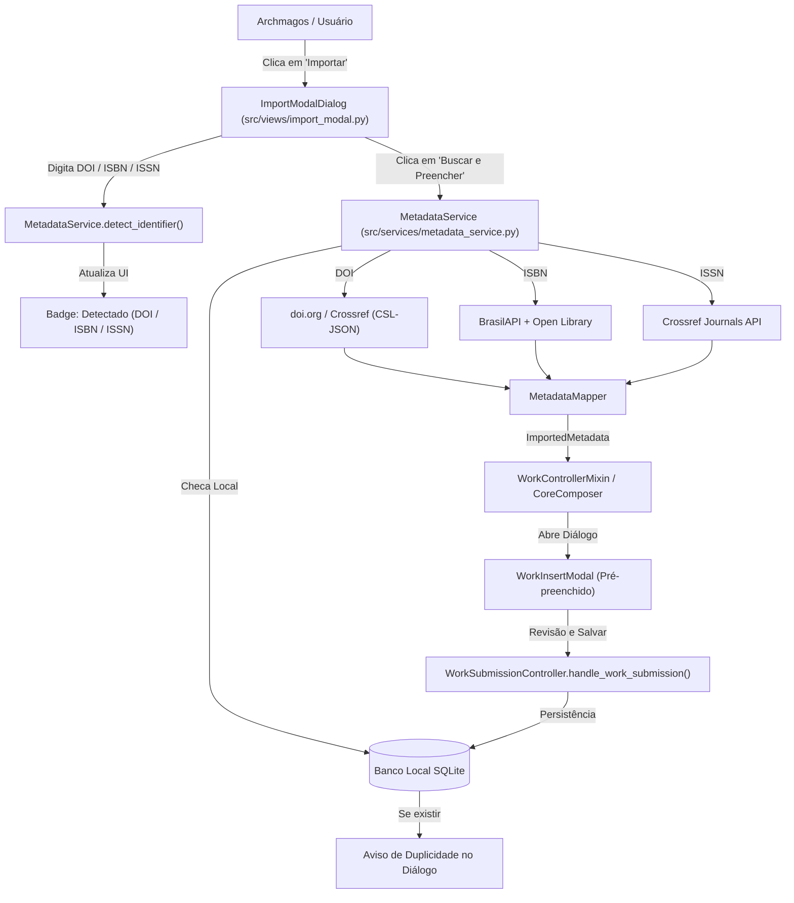

# Plano de Implementação: Subsistema de Importação de Metadados (DOI, ISBN, ISSN)

Este documento detalha o projeto técnico para implementar a funcionalidade de importação de metadados bibliográficos em **Hupomnemata**, habilitando a captura automatizada via **DOI** (Crossref / content negotiation), **ISBN** (BrasilAPI / Open Library) e **ISSN** (Crossref Journals), integrando-se diretamente ao fluxo existente de cadastro e validação de obras.

---

## 1. Goal Description

Permitir que o usuário insira obras rapidamente no Acervo e no Dashboard através de um único campo inteligente que identifica automaticamente se a entrada é um DOI, ISBN ou ISSN, busca os metadados bibliográficos em serviços abertos na nuvem, valida duplicidades no banco de dados local e abre o formulário de cadastro (`WorkInsertModal`) pré-preenchido com todos os campos mapeados (título, subtítulo, autores, ano, editora, revista, volume, páginas e identificadores) para revisão e salvamento seguro.

---

## 2. Decisões de Arquitetura Alinhadas no Rito /grill-me

| Decisão | Resolução Escolhida | Justificativa |
|---|---|---|
| **Fluxo de Interação** | Modal Pré-Preenchido (`WorkInsertModal`) | Permite revisão dos dados importados pelo usuário antes de persistir, mantendo a integridade cadastral e resolução de autores homônimos já existente. |
| **Entrada do Usuário** | Campo único com Auto-Detecção | Reconhece via expressões regulares padrões DOI (`10.xxxx/...`), ISBN (10 ou 13 dígitos) e ISSN (`xxxx-xxxx`), reduzindo atrito cognitivo. |
| **Tratamento de ISSN** | Cadastro como *Coleção Periódica* (`periodical_collection`) | O ISSN referencia a publicação seriada/revista e não um artigo isolado. Preenche título do periódico, editora e ISSN. |
| **Verificação de Duplicidade** | Aviso consultivo com atalho | Se o identificador já constar no banco local, exibe alerta com link para ver a obra existente ou prosseguir mesmo assim. |
| **Tratamento de Erros** | Feedback Inline no Diálogo | Mantém o diálogo aberto com a mensagem de erro detalhada e o texto digitado preservado para correção rápida. |
| **Stack de Rede** | `httpx` (já instalado no ambiente venv) | Assíncrono/síncrono, leve, sem dependências adicionais e compatível com CSL-JSON. |

---

## 3. Arquitetura dos Componentes



---

## 4. Proposed Changes

### Componente 1: Serviço de Resolução de Metadados (`src/services/metadata_service.py`)

#### [NEW] `src/services/metadata_service.py`
- **Responsabilidades**:
  - Detecção de formato de identificador (`IdentifierType`: `DOI`, `ISBN`, `ISSN`, `UNKNOWN`).
  - Normalização de entradas (remoção de prefixos `https://doi.org/`, hífens de ISBN/ISSN, espaços).
  - Consulta remota com timeout seguro (10s) e tratamento de falhas de conexão/HTTP (404, 429, 500).
  - Consulta ao banco local via `WorkRepository` para checagem de duplicidade prévia.
  - Mapeamento para o formato canônico consumido pelo `WorkInsertModal`:
    - `work_type`: tipo correspondente em Hupomnemata (`journal_article`, `editorial_monograph`, `periodical_collection`, etc.).
    - `values`: dicionário com `title`, `subtitle`, `publisher`, `publication_place`, `display_year`, `date_anchor`, `volume`, `number`, `part_start_page`, `part_end_page`, `isbn`, `issn`.
    - `authors`: lista de `AuthorReference` (`name`, `is_corporate`, `is_main`, `is_secondary`).

### Componente 2: Diálogo Visual de Importação (`src/views/import_modal.py`)

#### [NEW] `src/views/import_modal.py`
- **Estrutura**:
  - Modal estilizado com `ui_kit` (`bg`, `card`, `border`, tipografia Montserrat).
  - Campo de entrada com escuta `on_change` para auto-detecção em tempo real e exibição de badge ("Detectado: DOI", "Detectado: ISBN", "Detectado: ISSN").
  - Área de status e progresso: indicador circular de carregamento, mensagens de erro inline e alerta de duplicidade.
  - Ações: "Cancelar" e "Buscar e Preencher" (com acionamento via `Enter`).

### Componente 3: Integração no Controlador de Obras (`src/controllers/handlers/work_handler.py`)

#### [MODIFY] `src/controllers/handlers/work_handler.py`
- Adicionar método `open_import_work(self)`:
  - Instancia o `ImportModalDialog`.
  - Conecta a busca remota com a abertura do `WorkInsertModal` pré-preenchido (`initial_work_type`, `initial_values`, `initial_author_references`).
- Adicionar checagem de duplicidade de identificador no repositório.

### Componente 4: Integração na Interface do Acervo e Dashboard

#### [MODIFY] `src/views/works.py`
- Habilitar o botão `Importar` no cabeçalho do Acervo (linha 938):
  - Remover `disabled=True`.
  - Conectar ao callback `on_import_work`.

#### [MODIFY] `src/views/dashboard.py`
- Habilitar o atalho `Importar metadados` no Dashboard:
  - Remover `planned=True`.
  - Conectar ao evento `on_import_work`.

#### [MODIFY] `src/controllers/core_controller.py` e `src/views/core_composer.py`
- Encaminhar `on_import_work` para as visões correspondentes.

---

## 5. Verification Plan

### Testes Automatizados
Executar testes unitários com mocks de requisições HTTP para validar o isolamento e robustez:
1. **Detecção de Identificadores**:
   - `test_detect_doi_formats` (DOIs puros, URLs completas, sufixos especiais).
   - `test_detect_isbn_formats` (ISBN-10, ISBN-13, com e sem hífen).
   - `test_detect_issn_formats` (com e sem hífen).
2. **Mapeamento de Metadados**:
   - `test_crossref_doi_mapping` (valida conversão de CSL-JSON para `journal_article` e `editorial_monograph`).
   - `test_isbn_mapping` (valida conversão OpenLibrary / BrasilAPI para `editorial_monograph`).
   - `test_issn_mapping` (valida conversão para `periodical_collection`).
3. **Resiliência e Erros**:
   - `test_import_not_found_raises_clean_error`.
   - `test_import_duplicate_detection`.
   - `test_import_timeout_handling`.
4. **Bateria Geral**:
   ```powershell
   python -m pytest tests/test_metadata_import.py
   python -m pytest
   ```

### Verificação Manual
1. Abrir a aplicação (`python main.py`).
2. No Acervo, clicar no botão **Importar**.
3. Inserir o DOI `10.1038/nature.2014.14583` e clicar em **Buscar e Preencher**:
   - Verificar se o badge "Detectado: DOI" aparece.
   - Verificar se o modal de cadastro abre pré-preenchido como "Artigo de revista", com título "Stephen Hawking: 'There are no black holes'", revista "Nature", ano "2014" e autora "Zeeya Merali".
4. Cancelar e testar com o ISBN `9788575594841`:
   - Verificar pré-preenchimento como "Livros em geral", editora "Boitempo", etc.
5. Inserir o ISSN `0101-3300`:
   - Verificar pré-preenchimento como "Coleção periódica", revista "Novos Estudos - CEBRAP".
6. Testar identificador inválido e verificar mensagem inline de erro sem fechar a janela.
